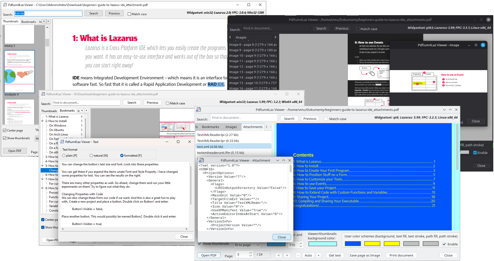

# pdfium4laz

Object Pascal bindings and visual components for the [PDFium](https://pdfium.googlesource.com/pdfium/) library,
for Free Pascal and Lazarus. It lets you view, search, extract content from and edit PDF files without any
external tools - only the PDFium shared library is required.



## Features

The package contains **2 visual components** (installed on the **PDFium** tab of the component palette):

- **TPdfViewer** - a scrollable single-page viewer with background (threaded) rendering, zoom modes
  (manual, fit width, fit height, fit page), text selection with mouse and keyboard (Ctrl+A, Ctrl+C),
  clickable links, bookmark navigation, an optional color scheme (e.g. dark mode) and image color inversion.
- **TPdfThumbnailPanel** - a page thumbnail strip (vertical or horizontal) rendered in a background thread,
  with page captions, selection and click events. 

### Reading PDF files

- Opening documents from a file or a stream, including password-protected documents
- Document information: metadata (title, author, ...), permissions, encryption, PDF version,
  file identifier, form type, language, page labels
- Rendering pages to a `TBitmap` (also with a custom color scheme)
- Text extraction in 3 formats (plain, natural reading order, layout preserving), text search,
  text selection, text from a rectangle
- Links (URI, go-to page, remote go-to, launch)
- Bookmarks (outline tree with target page, position and color)
- Embedded images - listing, metadata (pixel size, DPI), export to PNG, JPEG or BMP
- File attachments - listing, metadata, extraction
- Printing (synchronous or in a background thread), with page ranges like `1-3,5,8`

### Modifying PDF files

- Merging several PDF files into one
- Splitting a document - every page to its own file, a page range, or any selection of pages
- Moving (reordering) pages
- Rotating pages
- Adding and deleting file attachments
- Saving the document, optionally as a different PDF version (1.4, 1.5, 1.6, 1.7, 2.0)

## Requirements

| | |
|---|---|
| Operating systems | Windows 32-bit, Windows 64-bit, Linux 64-bit, MacOS arm64 |
| Compiler | FPC 3.0.4 or newer |
| IDE | Lazarus 2.0 or newer |
| PDFium | build **6036** or newer |

Precompiled PDFium libraries can be downloaded from
[https://github.com/bblanchon/pdfium-binaries/releases](https://github.com/bblanchon/pdfium-binaries/releases).

## Installation

1. Open `pdfium4laz.lpk` in Lazarus (*Package > Open Package File*).
2. Compile it and choose *Use > Install* to put `TPdfViewer` and `TPdfThumbnailPanel` on the component palette
   (Lazarus rebuilds itself).
3. Put the PDFium library (`pdfium.dll` on Windows, `libpdfium.so` on Linux) next to your application
   executable - see [Initialization](#initialization).

If you use printing (`PdfiumPrint` unit), add the standard **Printer4Lazarus** package to your project.

## Demos

- `demo/view` - viewer: page view, thumbnails, bookmarks, search, text, images, attachments, printing, color scheme
- `demo/edit` - editing tools: merge, split, move pages, attachments, PDF version

## License and author

pdfium4laz is released under the **MIT License** - see [LICENSE](LICENSE).

Author: **Paweł Dmitruk** ([paweld](https://github.com/paweld))

---

# Getting started

## Units

| Unit | Contents |
|---|---|
| `PdfiumLib` | low-level PDFium API, library loading, `EPdfiumError` |
| `PdfiumCore` | `TPdfDocument`, `TPdfPage` |
| `PdfiumViewer` | `TPdfViewer` |
| `PdfiumThumbnails` | `TPdfThumbnailPanel` |
| `PdfiumText` | text extraction, search, selection |
| `PdfiumImages` | embedded images |
| `PdfiumAttachments` | file attachments |
| `PdfiumBookmarks` | bookmarks (outline) |
| `PdfiumLinks` | links |
| `PdfiumMerge` | merging and splitting |
| `PdfiumPrint` | printing |

Page indices are **0-based** everywhere (the only exception is the print page specification string,
which uses 1-based page numbers, like a print dialog).

## Initialization

The PDFium library must be loaded before it is used. You can do it explicitly with `PdfiumInitialize`,
optionally passing the full path to the library:

```pascal
uses
  PdfiumLib;

PdfiumInitialize;                              // automatic search
PdfiumInitialize('/opt/myapp/libpdfium.so');   // explicit location
```

When no path is given, the library is searched for in:

1. the application executable's directory,
2. the `lib` subdirectory of the executable's directory,
3. the standard search path of the operating system.

Accepted file names are `pdfium.dll`, `pdfium-x64.dll` / `pdfium_x64.dll` (`x86` for 32-bit) on Windows and
`libpdfium.so`, `libpdfium-x64.so` / `libpdfium_x64.so` on Linux.

`TPdfDocument.Create` also initializes the library, so calling `PdfiumInitialize` yourself is optional -
the constructor accepts the library path as well:

```pascal
Doc := TPdfDocument.Create;                      // automatic search
Doc := TPdfDocument.Create('C:\MyApp\pdfium.dll'); // explicit location
```

Initialization is reference-counted: every `PdfiumInitialize` must be paired with `PdfiumFinalize`, and
`TPdfDocument.Destroy` does that for its own constructor. A path is only used when the library is not loaded yet.

## Freeing objects

All objects created by you (`TPdfDocument`, `TPdfTextPage`, `TPdfImageList`, `TPdfAttachmentList`,
`TPdfBookmarkTree`, `TPdfLinkList`, `TPdfSearch`, ...) must be freed by you. Objects that belong to a document
(pages, text pages, image and attachment lists, bookmark trees) must be freed **before** the document itself.

`TPdfPage` objects returned by `Doc.Pages[]` are owned and freed by the document - do not free them.

Before freeing a document that is shown in a visual component, detach it first:

```pascal
PdfViewer1.Document := nil;
PdfThumbnailPanel1.Document := nil;
FreeAndNil(Doc);
```

## Opening a file

Errors are reported with `EPdfiumError`. When the document is encrypted, its `ErrorCode` is `FPDF_ERR_PASSWORD`
and you can try again with a password:

```pascal
uses
  PdfiumLib, PdfiumCore;

var
  Doc: TPdfDocument;
  Pwd: String;
begin
  Doc := TPdfDocument.Create;
  try
    try
      Doc.LoadFromFile(FileName);
    except
      on E: EPdfiumError do
      begin
        if (E.ErrorCode = FPDF_ERR_PASSWORD) and InputQuery('PDF', 'Password:', True, Pwd) then
          Doc.LoadFromFile(FileName, Pwd)  // raises EPdfiumError again if the password is wrong
        else
          raise;
      end;
    end;
  except
    FreeAndNil(Doc);
    raise;
  end;
  ShowMessage(Format('%d pages, PDF %d.%d', [Doc.PageCount, Doc.FileVersion div 10, Doc.FileVersion mod 10]));
end;
```

`LoadFromStream(AStream, APassword)` works the same way. The stream (and, for `LoadFromFile`, the file) is read
lazily, so it must stay available and unchanged while the document is open.

## Displaying a page

Drop a `TPdfViewer` (and optionally a `TPdfThumbnailPanel`) on a form and assign the document:

```pascal
PdfViewer1.Document := Doc;
PdfViewer1.ZoomToFitWidth;          // or ZoomToFitHeight, ZoomToFitPage, ZoomToActualSize, Zoom := 1.5

PdfThumbnailPanel1.Document := Doc;
```

Navigation and useful events:

```pascal
PdfViewer1.GotoPage(2);              // or PdfViewer1.PageIndex := 2
PdfViewer1.ZoomIn;                   // ZoomOut

procedure TForm1.PdfThumbnailPanel1PageClick(Sender: TObject; APageIndex: Integer);
begin
  PdfViewer1.GotoPage(APageIndex);
end;

procedure TForm1.PdfViewer1PageChanged(Sender: TObject);
begin
  PdfThumbnailPanel1.SelectedIndex := PdfViewer1.PageIndex;
  PdfThumbnailPanel1.ScrollToPage(PdfViewer1.PageIndex);
end;

procedure TForm1.PdfViewer1LinkClick(Sender: TObject; const ALink: TPdfLink);
begin
  case ALink.Kind of
    lkURI: OpenURL(ALink.URI);
    lkGoto: PdfViewer1.GotoPage(ALink.PageIndex);
  end;
end;
```

Dark mode: set `UseColorScheme := True` and the `Scheme*Color` properties on both components.

To render a page without the viewer (e.g. to save it as an image):

```pascal
Page := Doc.Pages[0];
Bmp := Page.RenderToBitmap(Round(Page.Width * 150 / 72), Round(Page.Height * 150 / 72)); // 150 DPI
try
  Bmp.SaveToFile('page1.bmp');
finally
  Bmp.Free;
end;
```

## Getting text from a page

```pascal
uses
  PdfiumText;

Memo1.Text := PdfGetText(Doc.Pages[0], tfNatural);
```

There are 3 text formats:

| Format | Result |
|---|---|
| `tfPlain` | Text exactly as PDFium returns it, in the order it is stored in the page content. Fast, but for multi-column or unusually generated documents the order may not match the visual layout. |
| `tfNatural` | Reading order rebuilt from character positions: characters are grouped into lines by their baseline, each line is sorted left to right, words are separated by single spaces and an empty line is inserted between paragraphs. Best for reading or further processing. |
| `tfFormatted` | Like `tfNatural`, but also keeps the horizontal layout: lines are indented and gaps between words are filled with a matching number of spaces, so columns and tables stay roughly aligned (best viewed with a monospaced font). |

For more control (search, character positions, text from a rectangle) use `TPdfTextPage`:

```pascal
TextPage := TPdfTextPage.Create(Doc.Pages[0]);
try
  S := TextPage.ExtractTextInRect(RectF(0, 800, 600, 700)); // PDF points, Y axis goes up
  Search := TPdfSearch.Create(TextPage, 'invoice', [sfMatchCase]);
  try
    if Search.FindNext(Match) then
      PdfViewer1.SelectTextRange(Match.StartIndex, Match.Count); // when the viewer shows that page
  finally
    Search.Free;
  end;
finally
  TextPage.Free;
end;
```

## Getting images

```pascal
uses
  PdfiumImages;

var
  Images: TPdfImageList;
  i: Integer;
begin
  Images := TPdfImageList.CreateForDocument(Doc);   // or CreateForPage(Doc.Pages[0])
  try
    for i := 0 to Images.Count - 1 do
    begin
      Memo1.Lines.Add(Format('page %d: %d x %d px', [Images[i].PageIndex + 1, Images[i].PixelWidth, Images[i].PixelHeight]));
      Images[i].SaveToFile(Format('image_%d.png', [i + 1]));  // format from extension: .png, .jpg, .bmp
    end;
  finally
    Images.Free;
  end;
end;
```

`ToBitmap` returns a `TBitmap` (to be freed by the caller) and `SaveToStream(Stream, ifJpeg)` writes to a stream.

## Getting attachments

```pascal
uses
  PdfiumAttachments;

var
  Attachments: TPdfAttachmentList;
  Item: TPdfAttachmentItem;
begin
  Attachments := TPdfAttachmentList.Create(Doc);
  try
    for Item in Attachments do
    begin
      Memo1.Lines.Add(Format('%s (%d bytes) %s', [Item.Name, Item.Size, Item.Description]));
      Item.SaveToFile(OutputDir + Item.Name);    // or GetData: TBytes, SaveToStream
    end;
  finally
    Attachments.Free;
  end;
end;
```

## Getting bookmarks

`TPdfBookmarkTree` reads the whole outline at once. Each `TPdfBookmark` has a `Title`, a target `PageIndex`
(-1 when it has none), a vertical position `PageY` and its child bookmarks:

```pascal
uses
  PdfiumBookmarks;

procedure TForm1.AddNodes(AParent: TTreeNode; ABookmark: TPdfBookmark);
var
  Child: TPdfBookmark;
begin
  AParent := TreeView1.Items.AddChildObject(AParent, ABookmark.Title, ABookmark);
  for Child in ABookmark do
    AddNodes(AParent, Child);
end;

procedure TForm1.LoadBookmarks;
var
  Root: TPdfBookmark;
begin
  FBookmarks := TPdfBookmarkTree.Create(Doc);   // keep it alive as long as the tree nodes point to it
  for Root in FBookmarks do
    AddNodes(nil, Root);
end;

procedure TForm1.TreeView1SelectionChanged(Sender: TObject);
begin
  if TreeView1.Selected <> nil then
    PdfViewer1.GotoBookmark(TPdfBookmark(TreeView1.Selected.Data));
end;
```

---

# Editing PDF files

Changes made to a `TPdfDocument` exist only in memory until the document is saved with `SaveToFile` or
`SaveToStream`. A document opened with `LoadFromFile` cannot be saved over its own source file directly
(the file is read lazily) - save it to another file, or save to a `TMemoryStream`, close the document and
then write the stream to the file.

## Merging

```pascal
uses
  PdfiumMerge;

PdfMergeFiles(['part1.pdf', 'part2.pdf', 'part3.pdf'], 'merged.pdf');
```

`PdfMergeStreams` does the same with streams. The output file must not be one of the source files.

## Splitting

```pascal
uses
  PdfiumMerge;

// every listed page to its own file: OutputDir\page_0001.pdf, page_0003.pdf, ...
PdfSplitPages('source.pdf', 'C:\Output', [0, 2, 4]);

// pages 2-5 (0-based indices 1..4) to one file
PdfSplitRange('source.pdf', 'pages_2-5.pdf', 1, 4);

// any selection of pages, in the given order, to a stream
PdfSplitToStream(SourceStream, [4, 0, 1], DestStream);
```

## Moving pages

`MovePages` moves the given pages (0-based) so they start at the destination index of the resulting document:

```pascal
Doc.LoadFromFile('source.pdf');
Doc.MovePages([4], 0);          // the 5th page becomes the first one
Doc.MovePages([0, 1], 3);       // the first two pages move to positions 4 and 5
Doc.SaveToFile('reordered.pdf');
```

Pages can also be rotated - `Doc.Pages[0].SetRotation(90)` (0, 90, 180 or 270 degrees). If the document is
shown in a `TPdfViewer`, call `PdfViewer1.RefreshPage` afterwards (and `PdfThumbnailPanel1.InvalidateCache`).

## Adding attachments

```pascal
uses
  PdfiumAttachments;

var
  Attachments: TPdfAttachmentList;
  Item: TPdfAttachmentItem;
begin
  Attachments := TPdfAttachmentList.Create(Doc);
  try
    Item := Attachments.Add('data.xml');            // the name must be unique
    Item.SetData(FileBytes);                        // TBytes with the file content
    Item.SetDescription('Invoice data');
    Item.SetStringValue(PDF_ATTACHMENT_KEY_CREATIONDATE, FormatDateTime('"D:"yyyymmddhhnnss', Now));
    // Attachments.Delete(0);                       // removing an attachment
  finally
    Attachments.Free;
  end;
  Doc.SaveToFile('with_attachment.pdf');
end;
```

## Saving as a different PDF version

The second parameter of `SaveToFile` / `SaveToStream` forces the version of the saved file, using the same
encoding as `FileVersion` (14 = 1.4, 17 = 1.7, 20 = 2.0). `0` (the default) keeps the document's own version.

```pascal
Doc.LoadFromFile('source.pdf');
Doc.SaveToFile('source_pdf17.pdf', 17);
```
